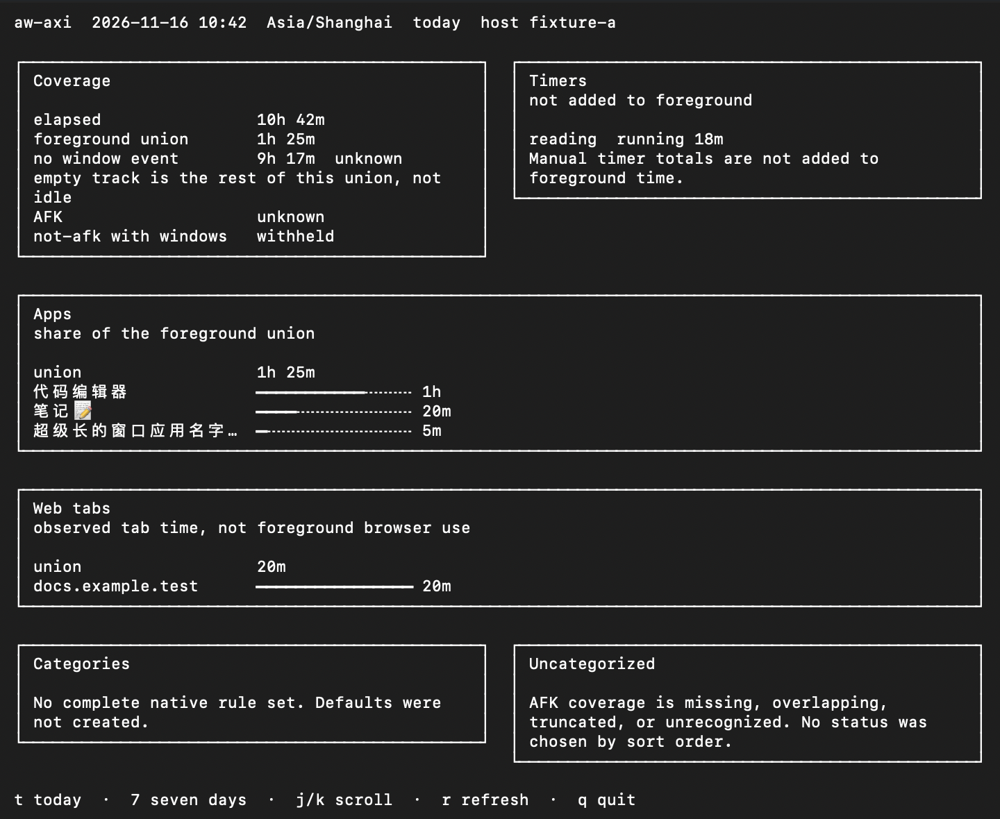

# aw-axi

An independently maintained local command-line client for [ActivityWatch](https://activitywatch.net/). It uses the server API and offers concise output for people and agents. It is not an official ActivityWatch component.

The read-only terminal dashboard presents separate cards for observed window, web, AFK and stopwatch data. Availability depends on the buckets and rules present; it is not a complete activity, AFK or category summary.

The first version starts, stops, and switches native stopwatch timers, totals one label, summarizes uncategorized app and domain time, edits explicit category rules, and adds the native Top Stopwatch Events panel to one selected view.

## Dashboard



The dashboard image is cropped from a previously captured native Terminal window using synthetic data. The crop removes the window title for privacy; the displayed product pixels are unchanged. A separate screenshot of the timer workflow is pending manual capture. The cards keep foreground, observed web tabs and manual timers separate, and mark incomplete coverage as unknown or withheld.

## Run

Node 24 or newer is required.
Time calculations use the pinned temporal-polyfill package, so Node 24 does not need a global Temporal object or an experimental flag.
Install the locked dependencies, then run the command through Node:

```sh
npm ci
node bin/aw-axi.js --help
# Set this to the address of your intended running ActivityWatch server.
export AWAXI_BASE_URL=http://127.0.0.1:57500
node bin/aw-axi.js timer status --base-url "$AWAXI_BASE_URL"
node bin/aw-axi.js --tui --base-url "$AWAXI_BASE_URL"
```

`--base-url` (or the `AWAXI_BASE_URL` environment variable) is required for every server command. Supply the HTTP or HTTPS origin, with an optional trailing slash.
There is no default port, so a command cannot reach a server by surprise.
The example port is illustrative; start or select your own server and use its actual address. Read-only status and dashboard commands above do not change server data. Before changing server data, select a private state directory.

For commands that support `--now`, that flag or `AWAXI_NOW` overrides the current time using a valid ISO 8601 date-time, for example `2026-11-15T00:00:00Z`. An explicit `--now` takes precedence. An explicit `Z` or numeric offset identifies an instant. Without an offset, the date-time uses the process's local timezone and selects the earlier instant if the clock repeats. Date-only, non-ISO, and nonexistent local times are rejected before server requests.

```sh
node bin/aw-axi.js timer start --label "Reading" --base-url "$AWAXI_BASE_URL" --state "$HOME/.local/state/activitywatch-axi"
node bin/aw-axi.js timer stop --label "Reading" --base-url "$AWAXI_BASE_URL" --state "$HOME/.local/state/activitywatch-axi"
node bin/aw-axi.js totals --label "Reading" --base-url "$AWAXI_BASE_URL"
```

Timer writes and `views add-stopwatch` require `--state` or `AWAXI_STATE`. Native server writes require explicit `--base-url` and `--state` flags. Use the same private state directory for all server settings writes so they share one lock. File exports and legacy file edits do not use the state lock. See [Native category rules](#native-category-rules).
Legacy `rules add` and `rules revert` coordinate through a private lock beside the resolved rules file. The lock covers the revision check through replacement and coordinates only cooperating CLI processes. Locks left after a crash are kept. Confirm that no command is running before manually removing a stale lock.
For legacy file edits, `--expect` is the SHA-256 of the entire file, including formatting. Run `rules preview --file <path>` to replace older revision tokens and after editing the file.
ActivityWatch does not provide a transaction that also covers the browser.

## Commands

- `timer start`, `timer stop`, `timer switch`, and `timer status` use a `general.stopwatch` bucket.
  A single existing stopwatch bucket is selected automatically; use `--bucket` to choose among several. When creating the first bucket, the default is `aw-stopwatch` with hostname `unknown`.
  Stop writes the same event id with `running: false` and the elapsed seconds.
  Starting a label that is already running does nothing.
- `totals` separates stored completed time from the current running elapsed time.
  Overlapping stored intervals are counted once.
  Window and AFK time is not added.
- `uncategorized` needs `--rules` with coverage `complete`, or the explicit `--server-rules` flag. Rule sets and their active selection must be valid and nonempty. App and observed web-tab totals are separate measures and must not be added together. Conflicting bucket hosts require `--host`. An existing AFK bucket must cover the requested range without gaps or overlaps; incomplete coverage and ambiguous overlapping app or domain identities are refused.
  It prints app names and reduced domains only.
- `rules` previews and edits explicit legacy rule files. The native path below reads, applies, and restores complete native category documents.
  `rules add` adds a regex alternative to the named category in the selected set. `--ignore-case` and comma-separated `--select-keys` also update existing rules. Repeating an exact stored pattern with unchanged modifiers is a no-op and creates no backup.
  Appending an alternative is refused if either pattern contains a backreference. File edits require verifiable plain permissions on the resolved file and staging directory; unsupported permission metadata is refused before replacement.
- `views show` reads the server layout.
  `views add-stopwatch` appends one `top_stopwatches` element to the view id you name.
- `aw-axi --tui --base-url <url>` is a read-only terminal dashboard.
  It does not take a subcommand and it does not change TOON output for the other commands.
  `--base-url` is still required. `--host` chooses among window, web, and AFK buckets.
  `--bucket` chooses among stopwatch buckets.
  The default range is today in `--timezone`, ending at one refresh anchor.
  `t` and `7` switch today and the last seven days when `--start` and `--end` are absent.
  `--once` and non-TTY output print the full report and exit.
  Foreground time is the union of window events. Time with no window event is unknown, not idle.
  Missing, overlapping, or unrecognized AFK time stays unknown. No AFK status is chosen by sort order.
  App rows and observed website-tab rows are separate measures. A tab duration is not foreground browser use.
  Manual timer totals stay on their own card and are not added to foreground time.
  Categories and uncategorized attribution stay withheld when the native rule set is missing or attribution would be misleading; desktop category totals remain withheld because window events do not carry browser URLs.
  Titles, full URLs, and raw events are not printed. Server-provided names are stripped of terminal control sequences.
  `NO_COLOR` and `TERM=dumb` keep the layout and drop color.
  `r` refreshes, `j` and `k` scroll, and `q` or Ctrl-C restore the cursor and leave the alternate screen.

To inspect existing categorization and views without writing:

```sh
node bin/aw-axi.js uncategorized --server-rules --base-url "$AWAXI_BASE_URL"
node bin/aw-axi.js views show --base-url "$AWAXI_BASE_URL"
```

A complete rules document can be supplied with `--rules` instead. To add the stopwatch panel, set `view_id` to the ID shown by `views show`. Use a fresh backup path for each change.

```sh
view_id='summary'
state_dir="${AWAXI_STATE:-$HOME/.local/state/activitywatch-axi}"
views_dir="$state_dir/views"
mkdir -p -m 700 "$state_dir" "$views_dir"
views_revision=$(node bin/aw-axi.js views show --base-url "$AWAXI_BASE_URL" | sed -n 's/^revision: //p')
node bin/aw-axi.js views add-stopwatch --id "$view_id" --expect "$views_revision" \
  --backup "$views_dir/before-add.json" --base-url "$AWAXI_BASE_URL" --state "$state_dir"
```

## Limits

A missing views setting stays missing. Missing native category settings require an explicit complete document and `--initialize`.
This CLI does not invent the web UI defaults and does not read a browser profile.
A file that contains only one category list is a partial export.
It can be previewed, and it is refused for categorization and for edits.
Server category writes are one setting key at a time.
The read-compare-write used before a settings change is not atomic with another writer.
A write that does not return a response is not sent again.
Each API call uses that route's canonical path and does not follow redirects.
The running `aw-axi` with no arguments shows whether a server is configured and how many timers are running.
It does not print timer labels.
`aw-axi update` is disabled, and this build does not install session hooks.

## Native category rules

The supported combination is Python or Rust ActivityWatch **v0.14.2**, with the verified released webUI bundle `index.15e65e70.js` (SHA256 `ecbfd637750abb8f7da32dbc32a8f6d41ba167f28dfb8ec0512e304429a94a40`). The backend and frontend are checked separately. Other versions/builds are refused. These commands accept only explicit HTTP loopback targets.

```sh
state_dir="${AWAXI_STATE:-$HOME/.local/state/activitywatch-axi}"
rules_dir="$state_dir/rules"
mkdir -p -m 700 "$state_dir" "$rules_dir"
node bin/aw-axi.js rules show --native --base-url "$AWAXI_BASE_URL"
export_revision=$(node bin/aw-axi.js rules export --native --base-url "$AWAXI_BASE_URL" \
  --file "$rules_dir/native.json" | sed -n 's/^revision: //p')
cp -i "$rules_dir/native.json" "$rules_dir/native-edited.json"
```

Edit `native-edited.json`, then preview and apply it using the revision from the export.

```sh
node bin/aw-axi.js rules preview --native --file "$rules_dir/native-edited.json" --full
node bin/aw-axi.js rules apply --server --file "$rules_dir/native-edited.json" \
  --base-url "$AWAXI_BASE_URL" --state "$state_dir" --expect "$export_revision" \
  --backup "$rules_dir/before-apply.json"
```

An unchanged document returns `no-op` without creating a backup. After a `persisted` result, you can restore the saved settings if needed. Inspect the current state and read its revision again before restoring.

```sh
restore_revision=$(node bin/aw-axi.js rules show --native --base-url "$AWAXI_BASE_URL" | sed -n 's/^revision: //p')
node bin/aw-axi.js rules revert --native --server --backup "$rules_dir/before-apply.json" \
  --save-backup "$rules_dir/before-restore.json" --base-url "$AWAXI_BASE_URL" \
  --state "$state_dir" --expect "$restore_revision"
```

Set `AWAXI_BASE_URL` to your HTTP loopback server. Keep the private rules directory outside your Git checkout. Choose unused paths for every export and backup. The CLI creates these files exclusively with mode 0600. They contain category configuration, which may include sensitive matching patterns. The CLI includes all server settings in the conflict revision and saves only the three category keys and target metadata in exports and backups. It does not fetch activity for these commands.

The exported `activitywatch-axi.native-rules.v1` document contains `target`, `coverage`, and `settings`. Edit a copy while retaining target metadata. A writable document must say `coverage: "complete"` and supply exactly `category_sets`, `active_set_ids`, and `classes` under `settings`. Include all sets, including disabled ones, in their intended order. Preserve unknown fields when editing. `classes` must exactly equal the effective categories after first-active-set priority, duplicate-name masking, and primary-set tombstones. The CLI validates this relationship without silently regenerating either representation. It preserves explicit category rule priorities and weights. Empty active selection and unknown schemas are refused because the native UI would substitute a fallback. Regex validation is conservative and requires JavaScript-compatible syntax; backend-specific regex syntax may be refused.

If the server keys are absent, the UI may still display native defaults or browser fallback categories. `rules show --native` reports presence separately from null. An absent export is a snapshot, not a complete intended taxonomy. Populate the complete document yourself and pass `--initialize` to `rules apply` explicitly. No rule defaults are synthesized. Partial existing configurations require reconciliation first. Python removes falsey settings, so states that cannot be faithfully restored (including explicit stored null or empty arrays) are refused. Rust restore uses DELETE for absence and POST for explicit null. Legacy server `rules add`/`revert` are refused; legacy file editing remains available.

`--expect` is the current revision from `rules show --native`, covering all server settings. Re-read it after any other edit. There is no transaction or compare-and-swap with the native browser: the CLI checks state before and after each changed key, stops on a conflict/uncertain response, and never retries or automatically rolls back. A backup can represent an interrupted partial write. Restore also takes a new private backup, requires the current revision, and restores the exact saved presence/value shape. A later failure can leave earlier keys persisted; inspect current state and the backup before explicitly restoring.

Success means **persisted**, with UI adoption explicitly unverified. Reload the intended native UI and check a known activity. Existing server values take priority over browser fallback; initialization may therefore mask a browser-local taxonomy. Browser storage is neither read nor modified. A stale native editing session can still overwrite changes later.

The verified desktop Activity query categorizes window events. Although its Browser view displays browser URLs, it does not merge those URL fields into the events used for Activity categories. An exact-domain rule with `select_keys: ["url"]` can be stored successfully without changing desktop Activity category totals. Tests verified this with a reserved synthetic domain and a lookalike domain; no URL-classification success is claimed for that view. This CLI does not change native query semantics or the separate AFK-overlap checks.

## Backend support and validation

Native rules are restricted to the exact v0.14.2 backend and webUI build described above. Other command paths use the ActivityWatch API, but acceptance against the latest releases, Windows or Linux, and Rust API-key authentication has not been established. Run `node bin/aw-axi.js <command> --help` for flags and examples.

`npm test` runs the synthetic CLI and TUI tests on Node 24 or newer. Put `python3` on PATH for the native numeric regressions and the terminal-session test. The terminal-session test requires Unix PTY support (`pty`, `fcntl`, and `termios`). The regression suite creates and removes scratch directories in the checkout, so the checkout must be writable. The CLI end-to-end, native fault, and official integration suites use `AWAXI_TEST_DATA` for scratch data when set and otherwise default to a temporary directory.

The native-rules fault tests require `AWAXI_TEST_WEBUI_BUNDLE` pointing to the verified v0.14.2 webUI JavaScript bundle. The official Rust integration test is macOS-specific and opt-in. Set `AWAXI_TEST_SERVER_BIN` and `AWAXI_TEST_WEBPATH` to an installed v0.14.2 Rust server and its web assets. The fixture starts a separate server with a fresh database, a sandbox, and an ephemeral loopback port other than 5600. The macOS fixture resolves its run directory to a canonical path and allows metadata access to its ancestor directories. Content and network access follow the sandbox in [test/official.test.js](test/official.test.js). The native-rules fault tests and official integration test are reported as skipped when their required fixture environment variables are absent.

## Privacy and recovery

The client connects only to the explicit server endpoint. Read operations can inspect activity and configuration on that server; writes can modify stopwatch events, rules or views. Treat output, rule exports and backups as potentially sensitive, and keep state and backup directories private. The CLI does not read browser profiles. Its lock coordinates only cooperating CLI processes using the same state directory; it cannot lock the browser or other clients. The server settings write sequence is nontransactional, without browser-wide locking or compare-and-swap. An uncertain write is not retried: inspect the server and backup before deciding how to recover.

## License

Project source is licensed under [MPL-2.0](LICENSE). Dependencies retain their own licenses; their texts are in [THIRD-PARTY-LICENSES](THIRD-PARTY-LICENSES/). ActivityWatch is a separate project with its own license.
